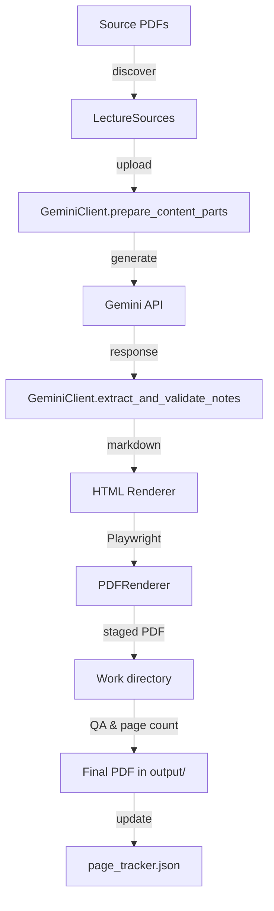

# Spring Boot Lecture Notes Automation

A **fully automated pipeline** that extracts source PDFs, generates lecture notes using Google Gemini, validates content, and renders a paginated study‑book PDF.

---

## 📑 Table of Contents
1. [Project Overview](#project-overview)
2. [Architecture Diagram](#architecture-diagram)
3. [Directory Layout](#directory-layout)
4. [Prerequisites](#prerequisites)
5. [Setup & Installation](#setup--installation)
6. [Configuration](#configuration)
7. [Usage](#usage)
8. [Testing](#testing)
9. [Troubleshooting](#troubleshooting)
10. [Release Checklist](#release-checklist)
11. [License & Disclaimer](#license--disclaimer)

---

## Project Overview
The pipeline stitches together three major stages:

1. **Source Discovery** – Detects primary, secondary and practice PDFs for each lecture.
2. **Content Generation** – Sends the extracted source files to the Google Gemini API, with configurable primary/fallback models and robust retry/back‑off handling.
3. **PDF Rendering** – Renders the generated markdown/HTML into an A4, black‑and‑white PDF via Playwright, ensuring continuous page numbering and correct pagination.

All stages are orchestrated by `build_notes.py` which updates a `page_tracker.json` to maintain a consistent page sequence across lectures.

---

## Architecture Diagram


---

## Directory Layout
```
.
├─ .env.example                # Example environment variables
├─ .gitignore                  # Excludes secrets, venv, output PDFs, etc.
├─ build_notes.py              # Main orchestration script
├─ requirements.txt            # Exact Python dependencies
├─ README.md                   # **This file**
├─ AUDIT_REPORT.md             # Final audit & hardening report
├─ pipeline/                   # Core pipeline modules
│   ├─ gemini_client.py        # Gemini integration, retries, fallback
│   ├─ sources.py              # Lecture source discovery logic
│   ├─ pdf_renderer.py         # Playwright rendering & PDF creation
│   └─ ...
├─ tests/                      # Unit & integration tests
├─ work/                       # Staging area (auto‑cleaned by pipeline)
├─ output/                     # Generated PDFs (ignored in Git)
└─ source/                     # Original PDF source files (not committed)
```

---

## Prerequisites
* Windows 10/11 (paths with spaces are supported)
* Python 3.11+ (tested with 3.11.9)
* PowerShell 5+ (default on Windows)
* [Google Gemini API key] – obtain from the Google AI Studio console.
* Playwright browsers – installed automatically by `pip install -r requirements.txt`.

---

## Setup & Installation
```powershell
# Clone the repo (user will do this locally)
# cd to the project root
cd "E:\Sujal Kadam\Programming Notes\Web Development\spring-notes-automation"

# Create a virtual environment
python -m venv .venv

# Activate it
.\.venv\Scripts\Activate.ps1

# Install dependencies
pip install -r requirements.txt

# Install Playwright browsers (required for PDF rendering)
playwright install
```

---

## Configuration
Copy the example file and fill in your API key:
```powershell
copy .env.example .env
# Edit .env (use any editor) and set:
# GEMINI_API_KEY=YOUR_KEY_HERE
# GEMINI_MODEL=gemini-3.6-flash   # primary – verified free‑tier model
# GEMINI_FALLBACK_MODEL=gemini-4-hydrogen
```
All values are read from the environment on each run.

---

## Usage
Generate a single lecture (e.g., Lecture 7):
```powershell
python build_notes.py 7
```
The script will:
1. Verify model availability.
2. Upload source PDFs.
3. Generate content with retries/fallback.
4. Render a PDF into `work/` and, after QA, atomically copy it to `output/`.
5. Update `page_tracker.json`.

To list the current pagination state:
```powershell
cat page_tracker.json
```

---

## Testing
Run the full test suite:
```powershell
python -m unittest discover -s tests
```
All tests should pass (`26 passed` at time of writing). The suite covers:
* Environment variable loading
* Model retry matrix
* Source discovery edge‑cases (unpadded lecture folders)
* Windows‑path handling with spaces
* PDF rendering fallbacks
* Page‑tracker integrity

---

## Troubleshooting
| Symptom | Likely Cause | Remedy |
|---|---|---|
| `HTTP 503` on primary model | Temporary demand spike | The pipeline retries; fallback to `gemini-4-hydrogen` after max retries. |
| `HTTP 404` on fallback model | Model not available for your account | Edit `.env` to a different accessible model (e.g., `gemini-3.5-flash`). |
| Playwright throws `Edge not found` | Edge browser not installed | The renderer now falls back to a bundled Chromium; ensure `playwright install` succeeded. |
| Lecture regeneration overwrites pagination | Forced regeneration without `--force` flag | Use `python build_notes.py 8 --force` only when you understand downstream impact – the script now warns you. |
| Tests fail due to missing PDFs | Source PDFs not present in `source/` | Verify that the original instructor PDFs are placed under `source/Lecture XX/`. |

---

## Release Checklist (GitHub‑ready)
- [x] `.gitignore` excludes secrets, virtual env, generated PDFs, and large source material.
- [x] `requirements.txt` pins all runtime dependencies.
- [x] `.env.example` contains placeholders only.
- [x] No API keys or copyrighted PDFs in the repo.
- [x] Comprehensive `README.md` (this file).
- [x] `AUDIT_REPORT.md` summarises audit findings and hardening steps.
- [x] All unit tests pass.
- [x] License placeholder added (user may choose MIT, Apache‑2.0, etc.).

---

## License & Disclaimer
Add a license file of your choice (e.g., MIT). The project is provided **as‑is**; the author does not guarantee model availability or quota limits.

---

*Generated by Antigravity – your AI‑powered engineering assistant.*